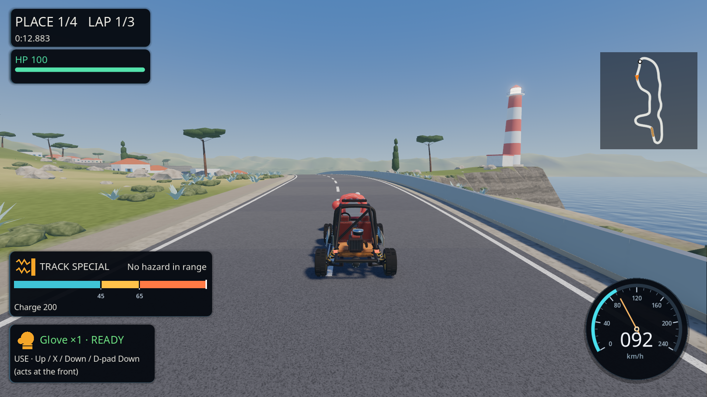
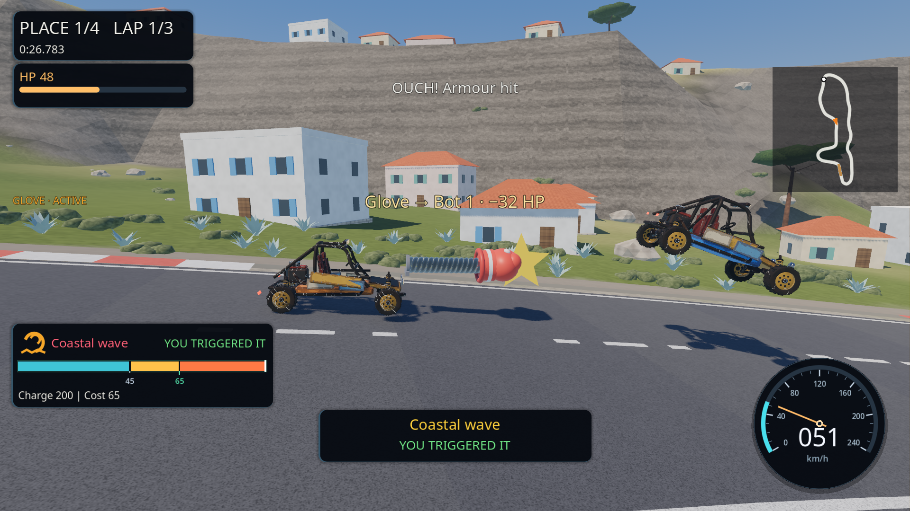

# Wreck Garage — Windows download

Build your own buggy, then wreck your friends with gloves, chainsaws and track hazards.

**[Download WreckGarage-Windows.zip](https://github.com/chentam/wreck-garage-downloads/releases/latest/download/WreckGarage-Windows.zip)** (about 64 MB)

| | |
|---|---|
| Public version | **1** — friend preview |
| Source build (technical) | `e6544706` |
| SHA-256 | `3fec4a760d0c0c85cf6544a114c10dfa5f5542b648d04d4f2588df87b604d0cb` |
| Platform | Windows 10/11, 64-bit. Nothing else to install. |

## How to play

1. Extract the **whole** ZIP (right-click, Extract All). Do not run the game from inside the ZIP.
2. Open the extracted folder and double-click **`Play-Wreck-Garage.cmd`**. It starts the game and keeps your settings and garage in a `save-data` folder next to it.
3. Pick *Offline Combat* to race against bots. Press Escape in a race for the controls.

The EXE is not code-signed, so Windows SmartScreen may warn on first run: choose *More info*, then *Run anyway*.
To check your download, compare its SHA-256 with the one above (`certutil -hashfile WreckGarage-Windows.zip SHA256`).

## Known issues

- This is a friend test build, not a final release.
- LAN multiplayer is not qualified yet. Play offline unless you are testing LAN on purpose.
- If it stutters on a laptop: Settings > Graphics > Track > Extra Low.

## Screenshots

Captured from this exact build at 1920x1080. Some combat moments (the glove hit, the chainsaw) were set up by script so they could be photographed.

| | |
|---|---|
|  Close racing off the Saltcliff start line |  Boxing glove launches a rival |
|  Handbrake drift, Forest Ridge |  Racing past the Giza pyramids |
|  Chainsaw ready inside the Giza tunnel | |

The ZIP includes the Godot Engine and Unicode licence files.

## Public version numbers

Public versions are sequential integers: **1, 2, 3, ...**. Increment only when a new game ZIP is published to the website. Source commits, local builds, documentation, screenshots and website-only edits do not increment the game version. SHA remains technical provenance.

The website reads [release.json](release.json) from main on page load and uses its version and pinned download URL together. No website redeploy is needed for a new game version. A browser refresh picks up the published manifest (subject to GitHub propagation).

### Publishing the next version

1. Read the current release.json; reserve the next integer only for an intended public publication. Bundle fixes; do not publish each commit.
2. Put the intended public version in BUILD.json as public_version, the test guide and the game's visible version display where supported. Preserve source SHA and all normal qualification checks. Internal candidates must not claim to be publicly released.
3. Build and verify the final ZIP; compute its SHA-256 and size. Use an immutable release tag such as v2 and title “Wreck Garage — Version 2”. Keep the asset name WreckGarage-Windows.zip.
4. Upload/publish the complete release and check the asset anonymously before switching the website. Do not overwrite previously published version assets.
5. Update release.json on main LAST, as a single commit, with schema_version: 1, version (integer), channel, published_at (ISO UTC), release_tag, release_url, download_url (tag-pinned), source_commit, sha256 and size_bytes. Keep the GitHub Latest release aligned. Never point the manifest at a draft/missing asset. Failed staging does not advance the website version.
6. Update this README's version and checksum and the central project tracker/handoff. Verify the live website number and anonymous download hash match. Record feedback against the public version.

Version 1 retroactively identifies the existing friends-r5-e6544706 ZIP. Its bytes and checksum are unchanged; its internal BUILD.json/EXE predate public numbering. Do not rebuild or rewrite it just to add the label. Starting with version 2, include the number inside the package as above.
