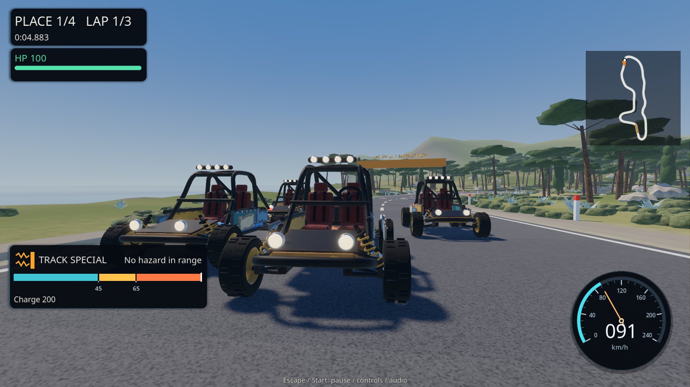
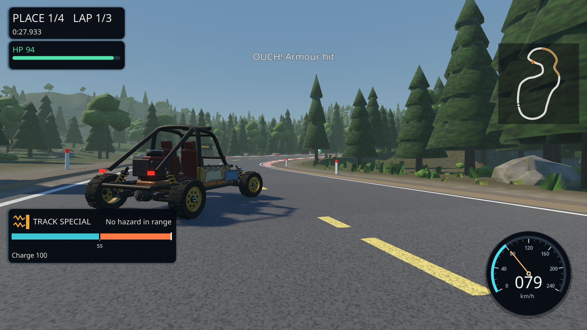
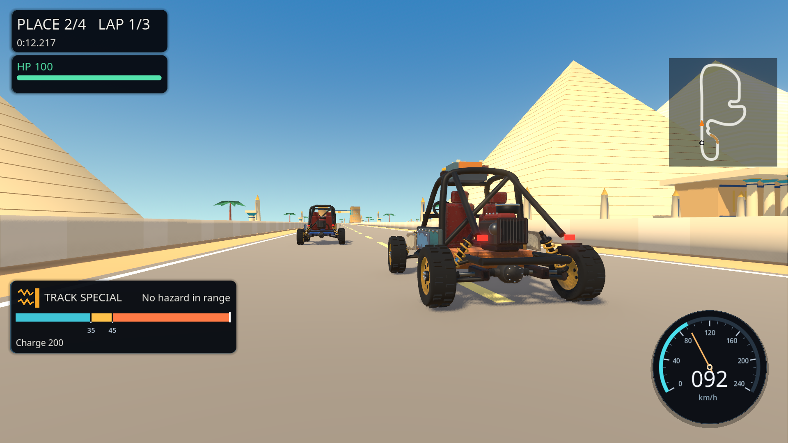
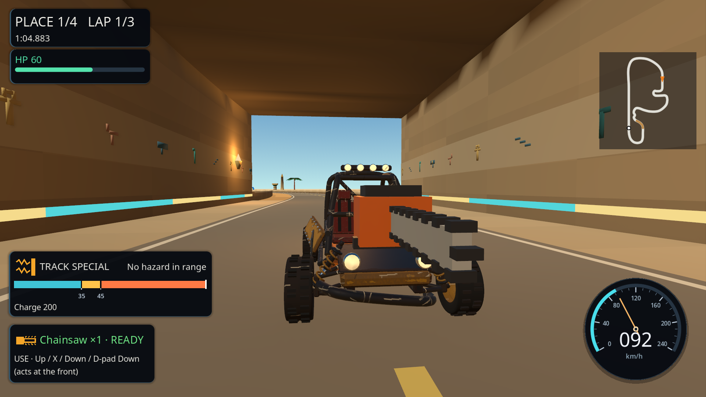

# Wreck Garage — Windows download

Build your own buggy, then wreck your friends with gloves, chainsaws and track hazards.

**[Download WreckGarage-Windows.zip](https://github.com/chentam/wreck-garage-downloads/releases/latest/download/WreckGarage-Windows.zip)** (about 64 MB)

| | |
|---|---|
| Build | Round 5 friend test, build ID `e6544706` |
| SHA-256 | `3fec4a760d0c0c85cf6544a114c10dfa5f5542b648d04d4f2588df87b604d0cb` |
| Platform | Windows 10/11, 64-bit. Nothing else to install. |

## How to play

1. Extract the **whole** ZIP (right-click, Extract All). Do not run the game from inside the ZIP.
2. Open the extracted folder and double-click **`Play-Wreck-Garage.cmd`**. It starts the game and keeps your settings and garage in a `save-data` folder next to it.
3. Pick *Offline Combat* to race against bots. Press Escape in a race for the controls.

The EXE is not code-signed, so Windows SmartScreen may warn on first run: choose *More info*, then *Run anyway*.
To check your download, compare its SHA-256 with the one above (`certutil -hashfile WreckGarage-Windows.zip SHA256`).

## Known issues

- This is a friend test build, not a final release.
- LAN multiplayer is not qualified yet. Play offline unless you are testing LAN on purpose.
- If it stutters on a laptop: Settings > Graphics > Track > Extra Low.

## Screenshots

Captured from this exact build at 1920x1080. Some combat moments (the glove hit, the chainsaw) were set up by script so they could be photographed.

| | |
|---|---|
|  Close racing off the Saltcliff start line |  Boxing glove launches a rival |
|  Handbrake drift, Forest Ridge |  Racing past the Giza pyramids |
|  Chainsaw ready inside the Giza tunnel | |

The ZIP includes the Godot Engine and Unicode licence files.
